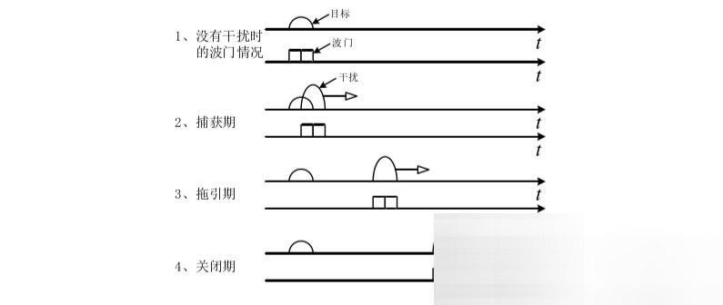
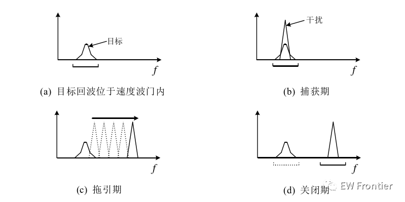
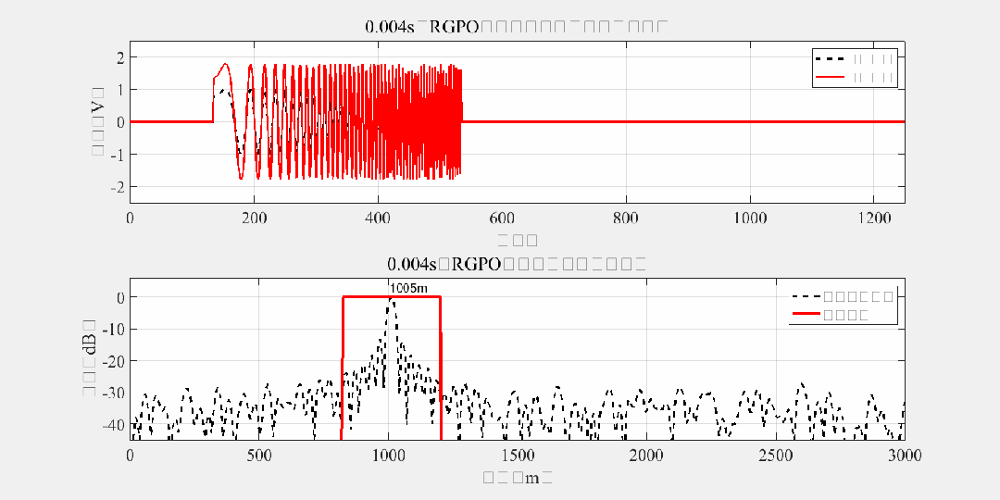

# Distance Wave Gate Tractoring Interference Simulation Code

Active jamming is a form of electromagnetic interference deliberately emitted by the enemy through specific sources to actively radiate towards radars. It primarily includes suppressive and deceptive interference. Suppressive interference has no correlation with radar signals, and most modern radar receivers employ coherent processing techniques, which significantly reduce the interference energy and result in unsatisfactory interference effects. Deceptive interference, on the other hand, has a high correlation with radar signals, and conventional pulse compression and other coherent processing techniques are unable to suppress active deceptive interference. Therefore, compared to suppressive interference, active deceptive interference poses a greater threat to radar systems.
Deceptive interference can disrupt the radar's search and tracking system to protect targets from being detected or tracked by radar. Active deceptive interference can be categorized into centroid jamming, beam-steering jamming, and pseudo target jamming based on the degree of difference with target parameters. Centroid jamming has the smallest difference with the target and has a less noticeable effect on pulse-compressed radars, which are generally treated together with the target [40]. Hence, this paper mainly discusses pseudo target and beam-steering jamming.
1. Beam-steering jamming
Beam-steering jamming is a type of periodically changing interference signal from centroid jamming to pseudo target jamming [40]. Based on the different interference effects, beam-steering jamming can be further divided into distance beam-steering and velocity beam-steering jamming. Distance beam-steering jamming is commonly used to disrupt the radar's range tracking system.
Figure 1 shows the changes in the radar's range gate when an enemy radar is subjected to distance beam-steering jamming [41]. The detailed working process of distance beam-steering jamming is as follows:
(1) Capturing phase: The jammer amplifies the intercepted radar signal by 1.3~1.5 times before forwarding it. Since the radar's automatic gain control (AGC) circuit generally tracks high-power signals, the jammer captures the radar's range tracking gate.
(2) Steering phase: The jammer gradually increases or decreases the delay time, causing the range gate to gradually move away from the real target. At this point, it is necessary to ensure that the steering speed does not exceed the maximum moving speed of the gate to avoid being identified by the radar.
(3) Shutdown phase: After a period of shutting down the jammer, the radar's range gate will completely disengage from the real target and have to re-search for the target. If the radar locks onto the target again, the jammer repeats the above process, preventing the radar from accurately measuring the distance parameters of the real target.
Figure 1: The process of distance dragging interference
Based on the difference in delay parameters during the propulsion phase, there are two types of distance propulsion: front propulsion and rear propulsion. In the propulsion phase, the interference machine gradually reduces the forwarding delay, leading to the distance gate moving towards the direction of reduced radar range. At this time, the distance information detected by the radar will be less than the actual target distance. Front propulsion is easily discerned by radar and is therefore not commonly used. Conversely, rear propulsion creates the illusion of an increasing target distance.
\t  
2. Speed wave gate dragging interference
Speed gate interference is commonly used to disrupt velocity tracking systems. Figure 2 shows the changes in radar velocity gates under speed gate interference [41]. After successfully identifying the radar's operational parameters, the jammer adds a false Doppler frequency to the intercepted radar signal and amplifies it for transmission to the radar receiver. Meanwhile, the AGC circuit responds to the high-power signal, thus capturing the radar velocity tracking gate (with a capture period of approximately 0.5~2 seconds) [42]. Then, the jammer gradually moves away from the interfered Doppler frequency (with a dragging period where the dragging speed should not exceed the target's maximum acceleration) [42]. When the velocity tracking gate is dragged away from the target's velocity gate by multiple gate widths, the jammer is turned off for a period of time (with an off period of about 0.5~2 seconds), at which point the radar has to re-search for the real target due to losing the true target.
\t  
Figure 2: Speed dragging interference working process
References: Design and Simulation Analysis of Radar Interference Patterns [D]

## Images

<!-- PAYMENT_BLOCK -->

## Get this dataset

- Payment link (Stripe): [Buy now](https://buy.stripe.com/3cs8yP7sY87d0vu9AB)
- Payment QR code: 

<!-- /PAYMENT_BLOCK -->
